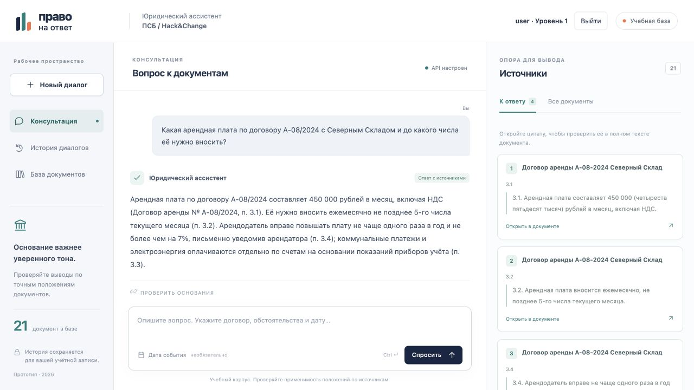
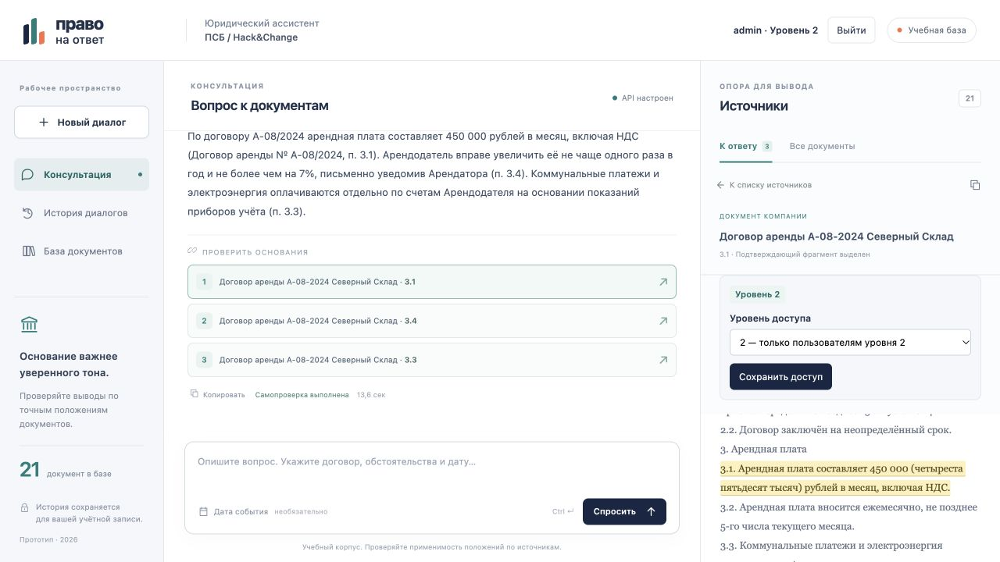
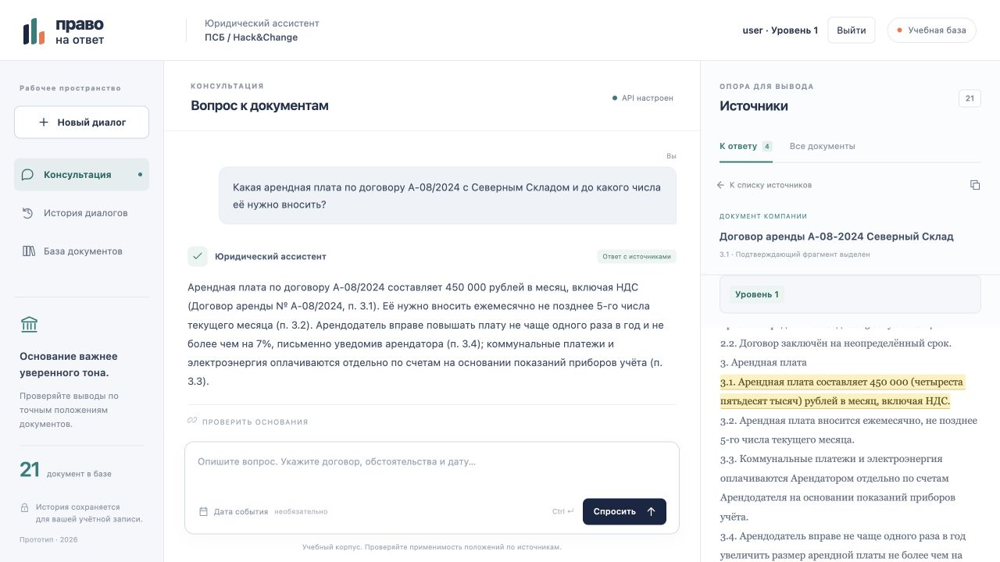
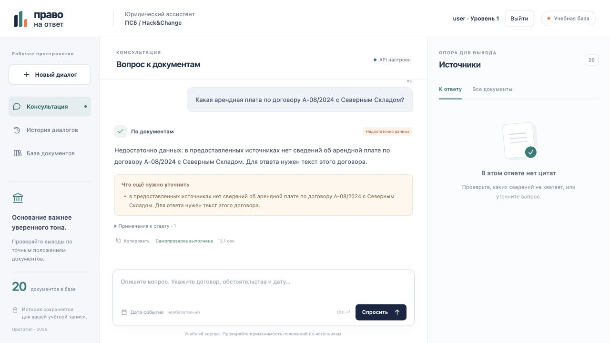

# Право на ответ — юридический ассистент ПСБ, веб-версия V21

Репозиторий: https://github.com/Mits2406/psb-legal-assistant

Ассистент помогает найти положения в предоставленной базе документов, выбрать договор и редакцию, получить краткий ответ с источниками или уточнить недостающие условия. Веб-версия V21 добавляет к ядру `LegalAssistant` вход, два уровня доступа к документам и серверную историю. Обработчик CSV сохраняет поведение V20.

В репозитории находятся исходники, веб-интерфейс V21, тестовая база, Docker-конфигурация, документация, [презентация V20](docs/presentation.pdf) и неизменённый [архив V20 для автоматического судьи](artifacts/submission-v20.zip). Новые функции доступа описаны в [инструкции V21](docs/access.md); PDF ещё относится к V20. Скрипты не отправляют решения организаторам.

## Как выглядит приложение

Скриншоты работающего локального прототипа V21. Для модельных ответов подключён адаптер Luna; это демонстрация интерфейса, не оценка качества DeepSeek организаторов.

**Ответ с источниками.** Ссылки позволяют открыть положения, на которых основан ответ.



**Управление доступом.** Администратор выбирает уровень 1 или 2 в просмотрщике документа.



<details>
<summary>Проверка цитаты и ответ при ограниченном доступе</summary>

**Точный фрагмент.** При переходе по ссылке цитата выделяется в исходном тексте.



**Ограниченный доступ.** Когда нужный договор недоступен пользователю уровня 1, ассистент сообщает о недостатке оснований для ответа.



</details>

## Быстрый запуск

Нужны Docker Engine с Docker Compose v2 или Docker Desktop. Из корня репозитория:

```sh
docker compose up --build
```

Откройте [http://127.0.0.1:8000](http://127.0.0.1:8000). При первом запуске создаются две учётные записи: `user` с уровнем 1 и `admin` с уровнем 2. Сгенерированные пароли находятся только в приватном файле контейнера; прочитайте его локально:

```sh
docker compose exec web cat /app/state/initial-credentials.txt
```

Остановка: `Ctrl+C`, затем при необходимости `docker compose down`. Состояние хранится в отдельном Docker volume `/app/state` и сохраняется между обычными перезапусками.

Без настроек API приложение работает в режиме поиска и точных выдержек: доступны разрешённые документы, источники, уточнения и история учётной записи. Это не режим генерации LLM. Для полноценного модельного ответа нужен доступ к совместимому прокси.

Docker-конфигурация включена в комплект; статус её фактической проверки указан в [отчёте о проверках](docs/evaluation.md). Запуск приложения без Docker требует Python 3.11+ и только стандартную библиотеку:

```sh
python3 app.py --host 127.0.0.1 --port 8000 --data-dir data
```

При прямом запуске пароли создаются в `state/initial-credentials.txt`. Вместо случайных паролей можно перед первым запуском задать в локальном `.env` переменные `PSB_USER_PASSWORD` и `PSB_ADMIN_PASSWORD` длиной от 8 символов. Они применяются только при создании пустой базы пользователей; изменение `.env` не меняет пароль существующей записи. `PSB_STATE_DIR` задаёт другой каталог состояния. Подробности: [учётные записи и хранение](docs/access.md).

Устанавливать пакеты из PyPI для приложения не требуется. `requirements.txt` фиксирует отсутствие сторонних зависимостей. Node.js нужен только для отдельного теста истории, а не для запуска сайта.

## Уровни доступа

| Пользователь | Какие документы видит | Может менять пометки |
|---|---|---|
| `user`, уровень 1 | Без пометки или с уровнем 1 | Нет |
| `admin`, уровень 2 | Все документы | Да: открыть документ, выбрать 1 или 2, нажать «Сохранить доступ» |

При первой загрузке все документы без пометок. Права проверяет сервер: скрытый документ недоступен также по прямому API-запросу. До поиска строится корпус только из разрешённых документов; векторизация, реранжирование, генерация и самопроверка работают с этой областью доступа.

Диалоги сохраняются в SQLite для конкретной учётной записи и редакции прав (`acl_revision`). Изменение пометки начинает новый контекст для всех пользователей: прежние ответы больше не загружаются в интерфейс и не передаются модели. При выходе браузер очищает документы и сообщения; история не записывается в `localStorage`. Старые записи остаются на сервере до удаления истории.

## Подключение моделей

```sh
cp .env.example .env
```

Заполните в `.env` адрес прокси, ключ и фактические идентификаторы моделей. Перезапустите приложение; для Compose повторите `docker compose up --build`.

| Параметр | Назначение |
|---|---|
| `LLM_BASE_URL` или `OPENAI_BASE_URL` | Адрес OpenAI-совместимого прокси |
| `LLM_API_KEY` или `OPENAI_API_KEY` | Ключ прокси |
| `LLM_MODEL`, `OPENAI_MODEL` или `GEN_MODEL` | Идентификатор генеративной модели; обязательно берётся из окружения |
| `EMB_MODEL` | Модель эмбеддингов; по умолчанию `baai/bge-m3` |
| `RERANKER_MODEL` | Идентификатор реранкера; без него реранжирование не вызывается |
| `RERANKER_API_KEY` | Необязательный отдельный ключ реранкера; иначе используется ключ LLM |
| `DATA_DIR` | Каталог с `knowledge-base.zip`; по умолчанию `data` |

Платформа хакатона описывает DeepSeek V4.1 Flash для генерации, BAAI/bge-m3 для эмбеддингов и необязательный Qwen3 Reranker 8B. Решение передаёт идентификаторы из окружения и не подменяет их фиксированными именами DeepSeek или Qwen. Нужны маршруты `/chat/completions`, `/embeddings` и, при включённом реранкере, `/rerank`.

Локальный адаптер Luna, использованный в отдельных экспериментах, в этот комплект не входит. Репозиторий не предоставляет бесплатный доступ к моделям и не содержит рабочих ключей. Не добавляйте `.env` в Git.

## Порядок проверки

1. Запустите приложение, войдите как `admin` и проверьте [состояние API](http://127.0.0.1:8000/api/health). До входа маршрут показывает только доступность сервера; после входа — режим API и доступный корпус.
2. Откройте базу документов: уровню 2 доступны 21 документ и просмотр точного текста.
3. Задайте: «Какая арендная плата по договору с ООО „Северный Склад“ и до какого числа её нужно вносить?» Проверьте источник с суммой 450 000 рублей и сроком оплаты до 5-го числа.
4. Начните новый диалог: «Нужно ли одобрение до 12 млн рублей?» На уточнение даты ответьте «2024». Проверьте, что исходный вопрос сохранён и рассматривается соответствующая редакция регламента.
5. Задайте: «Гарантия по П-99/2025?» Отсутствующий договор не должен подменяться похожим договором из базы.
6. Откройте источник из ответа и проверьте выделенный фрагмент. Перезагрузите страницу: завершённые диалоги восстановятся с сервера для этой учётной записи. Войдите как `user`: история администратора не должна появиться.
7. При подключённом API повторите сценарии: в ответе должны быть видны фактический режим LLM и статус самопроверки. Наличие ссылки само по себе не доказывает правильности вывода.
8. Под `admin` назначьте одному документу уровень 2. Под `user` проверьте отсутствие документа в списке и ответ 404 при запросе его API-адреса. Верните уровень 1 и убедитесь, что документ снова доступен. Подробнее: [проверка доступа](docs/review-checklist.md#6-два-уровня-доступа).

Подробный [чек-лист проверки](docs/review-checklist.md) отделяет ожидаемое поведение от измеренных результатов.

## Как устроено решение

```text
Учётная запись → разрешённые документы + серверная история текущей редакции прав
  → вопрос
  → восстановление контекста и уточнение применимости
  → BM25F + доступный BGE-M3 → объединение RRF
  → доступный реранкер → связанные положения и исключения
  → черновик LLM → самопроверка LLM
  → проверка цитат и оформление ответа
```

При недостатке условий ассистент уточняет договор или дату; при недостатке источников сообщает об ограничении. Сбой векторного поиска или реранкера сохраняет доступный текстовый поиск. При недоступной LLM возвращаются выдержки или явный технический статус, а не имитация модельного ответа.

В полной поставленной базе 21 документ: 8 документов компании и 13 текстов статей законов. Из 637 фрагментов рабочий поиск использует 441: исключены 13 служебных, 182 редакционных и 1 подозрительный блок. У пользователя уровня 1 объём дополнительно ограничен правами. `Document` хранит исходный текст, метаданные и SHA-256; `Chunk` — точный фрагмент, пункт и позиции `start/end`.

Готовый индекс содержит настоящие BGE-M3-векторы этих 441 поисковых фрагментов. При запуске документы читаются из фактического `DATA_DIR`. Индекс переиспользуется только для совпадающих входных текстов и после проверки совместимости пространства векторов с API. Вектор каждого нового вопроса всё равно требуется вычислить. Подробнее: [архитектура](docs/architecture.md).

## Основные настройки V20

Явно переданные параметры окружения имеют приоритет в пределах допустимых диапазонов кода.

| Параметр | По умолчанию | Смысл |
|---|---:|---|
| `MAX_TOKENS` | 8192 | Максимум на один вызов генерации, не требуемая длина ответа |
| `TEMPERATURE` | 0 | Передаваемая температура генерации |
| `MAX_WORKERS` | 4 | Параллельность CSV и Compose; прямой запуск `app.py` без настройки использует 2 |
| `ANSWER_TIMEOUT_SECONDS` | 120 | Максимум на вопрос с учётом остатка общего бюджета |
| `API_TIMEOUT_SECONDS` | 90 | Максимум ожидания одного API-вызова, ограниченный временем стадии |
| `RUN_TIMEOUT_SECONDS` | 1100 | Общий бюджет CSV-обработки |
| `ANSWER_VERIFY` | 1 | Самопроверка модельного черновика |
| `ENABLE_EMBEDDINGS` / `ENABLE_RERANKER` | 1 / 1 | Использование моделей при настроенном и доступном API |
| `RERANK_CANDIDATES` / `RERANKER_TOP_N` | 32 / 8 | Кандидаты реранкера и число приоритетных результатов |
| `RERANK_TIMEOUT_SECONDS` | 8 | Максимум ожидания реранкера |
| `QUERY_NORMALIZE` | 0 | Дополнительное модельное восстановление вопроса отключено; правила истории работают |

`TOP_K` и `CHUNKER` не управляют собственной реализацией поиска и разбиения. Неподтверждённые контрактом прокси параметры `thinking` или `reasoning_effort` не отправляются. Настройки V20 дают запас времени и токенов; они не являются экспериментально доказанным оптимумом качества модели организаторов.

## CSV и архив автоматического судьи

Входной CSV содержит `id,question`, выходной — `id,answer`. Для локального прогона публичных вопросов:

```sh
python3 solution.py --data-dir data --questions data/demo_questions.csv --output submission.csv --trace run_trace.jsonl
```

Для входа организаторов можно не передавать `--questions`: будет прочитан `DATA_DIR/questions.csv`. Каждая строка независима; история между ID не передаётся. Если диалог целиком записан в одном поле `question`, учитываются его реплики.

Пересобрать архив из текущего кода:

```sh
python3 build_submission.py --output artifacts/submission-v20.zip
```

Архив для автоматического судьи содержит 19 корневых файлов: модули исполнения, `requirements.txt` и готовый индекс. База и вопросы поступают от платформы. В архив не входят сайт, `access_control.py`, `scoped_assistant.py`, пользователи, презентация, тесты, ответы организаторов, ключи или история. Web V21 и его права доступа не изменяют контракт судьи `id,answer`. **Этот архив не заменяет полный комплект финальной сдачи.**

## Проверки и ограничения

```sh
python3 -m unittest discover -s tests -v
node tests/test_history_v11.js
python3 scripts/smoke.py
```

Для исходного комплекта V20 зафиксированы 303 Python-теста, 13 Node.js-тестов истории и `scripts/smoke.py` (HTTP, документы, уточнение с продолжением и CSV). Это результаты предыдущего выпуска. Проверки V21 дополняют их тестами [учётных записей](tests/test_access_control.py), [HTTP-доступа](tests/test_access_http.py) и [изоляции поиска и модельных вызовов](tests/test_scoped_access.py). Итоговые результаты нового прогона фиксируются отдельно в [отчёте](docs/evaluation.md). 19 файлов архива судьи V20 сохранены без изменений.

Эти проверки подтверждают поведение кода. Сборка Docker, запуск контейнера и HTTP health исходного V20 успешно проверены в GitHub Actions; ссылка ниже относится к тому выпуску. Реальный API организаторов, качество DeepSeek и балл закрытого судьи не проверены. Отдельное локальное сравнение V19 с Luna описано в [отчёте о качестве](docs/evaluation.md).

[GitHub Actions](.github/workflows/checks.yml) настроен на Python-тесты, историю браузера, воспроизводимость архива V20, сборку Docker и проверку HTTP после `push` или pull request. Workflow также допускает ручной запуск. [Первый запуск CI](https://github.com/Mits2406/psb-legal-assistant/actions/runs/43848023770) успешно завершился 16 ноября 2026 года: тесты, воспроизводимость архива, сборка Docker и HTTP health.

Ограничения текущего прототипа:

- Создаются две локальные учётные записи; интерфейса управления пользователями, SSO и смены паролей пока нет. SQLite и файл начальных паролей требуют приватного хранения; не включайте `state/` в репозиторий или архив.
- После изменения прав прежняя история скрывается целиком; выборочного восстановления безопасных сообщений пока нет. Уже переданные провайдеру запросы и ранее прочитанные пользователем документы отозвать невозможно.
- Самопроверка моделью не гарантирует юридическую правильность. При её сбое может сохраниться допустимый черновик; статус проверки доступен в ответе.
- Рабочий поиск ограничен предоставленной базой. Исключение известных подозрительных блоков не доказывает устойчивость к любым инструкциям в документах.
- Качество V20 на реальном API организаторов не измерено. Скорость зависит от моделей, размера контекста и нагрузки прокси.
- Публичные примеры использовались при разработке; они не являются независимой закрытой тестовой выборкой.

## Состав финальной сдачи

| Материал | Где проверить |
|---|---|
| Исходники веб-прототипа и CSV-движка | Корневые `.py`, `static/` |
| Запуск всех компонентов | `Dockerfile`, `compose.yaml`, `.dockerignore` |
| Настройки без секретов | `.env.example`, `.gitignore` |
| Зависимости | `requirements.txt` |
| Презентация | [docs/presentation.pdf](docs/presentation.pdf) |
| Архитектура и ограничения | [docs/architecture.md](docs/architecture.md) |
| Вход, два уровня доступа и серверная история V21 | [docs/access.md](docs/access.md) |
| Результаты и воспроизводимость проверок | [docs/evaluation.md](docs/evaluation.md), `tests/`, `evaluation/` |
| Порядок ручной проверки | [docs/review-checklist.md](docs/review-checklist.md) |
| ZIP для автоматического судьи | [artifacts/submission-v20.zip](artifacts/submission-v20.zip) |

Собрать полный комплект с исходниками, документацией, данными, тестами и презентацией:

```sh
python3 scripts/build_final.py --output dist/psb-final-v21.zip
```

В архив добавляется `MANIFEST.sha256` с контрольными суммами файлов. Сборка выполняется локально и ничего не отправляет организаторам.

При сдаче через PDF на первом слайде нужна ссылка на этот репозиторий. Для приватного репозитория по кейсу требуется доступ аккаунту жюри `hack-and-change-2026`. Альтернатива — полный ZIP с исходниками, документацией и презентацией. Локальный адрес `127.0.0.1` доступен только на компьютере, где запущено приложение, и не является публичным развёрнутым интерфейсом.
